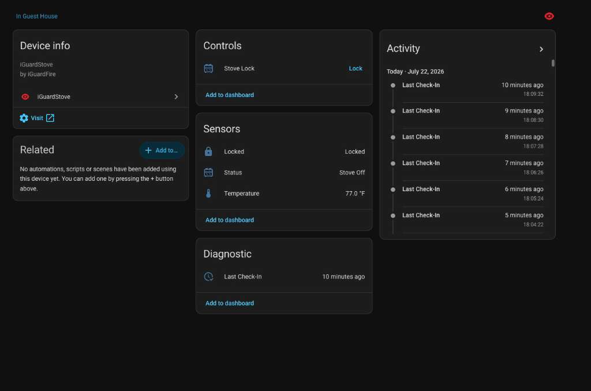

# iGuardStove for Home Assistant

See iGuardStove activity and stove status in Home Assistant, with optional controls for Master Lock.

> [!WARNING]
> **This integration can remotely control physical stove lockout hardware.** The Master lock entity is disabled by default. Enabling it allows remote locking; **Remote Unlock** is a separate permission and remains off by default. Voice assistants and automations can cause accidental activation. Do not use this integration as a replacement for safe supervision or the stove's safety equipment.
>
> Scheduled/Night Lock is separate: Remote Unlock does not clear it. Use the **Stove lockout** sensor or Status to see whether the stove is locked out. Upgrades retire the old `…_stove_lock` identity and create `…_master_lock` with a new entity ID; update affected automations using the [migration guide](docs/MIGRATION.md).

## What can I do with it?

- See stove status, ambient temperature, last check-in, and fires prevented.
- Receive events for activity such as motion, night lock, shutoff, or lost communication.
- Import [notification and event-action blueprints](docs/activity-and-automations.md). They do not automatically unlock the stove.
- Optionally enable the Master lock entity to lock the stove remotely. Unlocking additionally requires the Remote Unlock setting.

## Requirements and compatibility

You need Home Assistant **2026.9.0 or newer**, HACS (or the built-in Home Assistant Marketplace in **2026.11+**), an active iGuardFire account, at least one stove visible in its management portal, and internet access to `manage.iguardfire.com`. The integration signs in to the portal; iGuardFire does not currently provide a public smart-home API.

## Install with HACS or Home Assistant Marketplace

1. Click the **Open your Home Assistant instance** button above (backwards compatible: opens **HACS** on earlier versions and the built-in **Home Assistant Marketplace** on **2026.11+**), or manually add `https://github.com/andrewtryder/ha-iguardstove` as a custom repository in the **Integration** category.
2. Install **iGuardStove** and restart Home Assistant.

For manual installation, copy `custom_components/iguardstove` from a release into your Home Assistant configuration's `custom_components` directory and restart.

## First-time setup

1. Go to **Settings → Devices & services → Add integration** and select **iGuardStove**.
2. Enter your iGuardFire account email and password. Stoves on the account are discovered automatically.
3. If you want remote Master Lock control, explicitly enable the disabled **Master lock** entity. Remote unlocking additionally requires **Allow remote disengagement of Master Lock (Remote Unlock)** under the integration's **Configure** options.

## What you'll see in Home Assistant

Each stove can have status, last check-in, temperature, fires prevented, an activity event, and a **Stove lockout** sensor. The optional **Master lock** controls Master Lock only; Scheduled/Night Lock may still prevent stove use even when Master Lock is off. New stoves are discovered in the background.

## Common problems and troubleshooting

- If a stove is missing or unavailable, check the iGuardFire portal and the device's last check-in.
- If unlocking is unavailable, confirm that the entity is enabled and the separate Remote Unlock setting is on. Scheduled/Night Lock remains independent.
- After upgrading from the legacy lock entity or multiscrape blueprint, follow the [migration guide](docs/MIGRATION.md) and update automations to the new entity ID.
- Review logs and the [security policy](SECURITY.md) before opening an issue; never share credentials.

## Important limitations, safety, and privacy

Keep physical safety controls and supervision in place. Review the state of the stove before any remote action, and avoid automations that might lock or unlock it unexpectedly. The integration relies on the availability and behavior of the iGuardFire portal; it stores the account credentials through Home Assistant. See [SECURITY.md](SECURITY.md) for reporting and operational guidance.

## More documentation

- [Activity events and automation blueprints](docs/activity-and-automations.md)
- [Migration and entity ID changes](docs/MIGRATION.md)
- [Architecture](docs/ARCHITECTURE.md) and [contributing](CONTRIBUTING.md)

## Support and license

Open a [GitHub issue](https://github.com/andrewtryder/ha-iguardstove/issues) for reproducible problems. Removing the integration through **Settings → Devices & services** does not change portal settings, schedules, or the physical stove configuration. After a manual install, remove the integration directory and restart Home Assistant.

This unofficial community project is not affiliated with or endorsed by iGuardStove or iGuardFire. See the [license](LICENSE).
